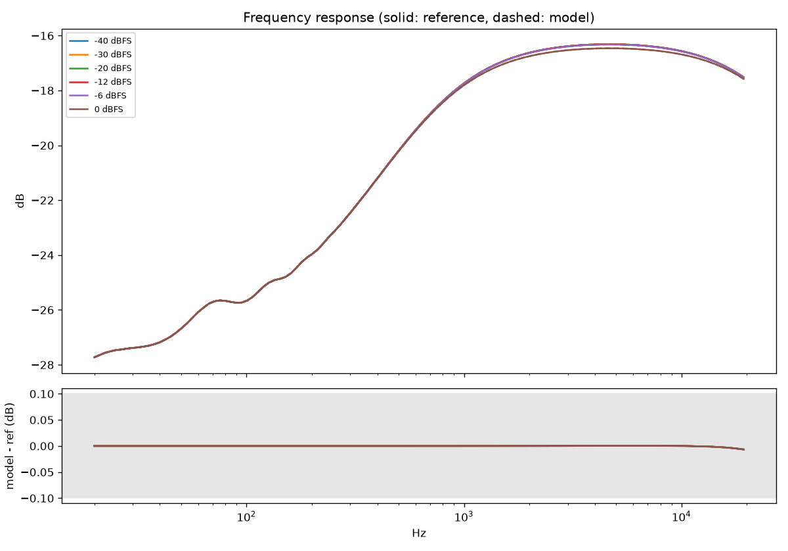
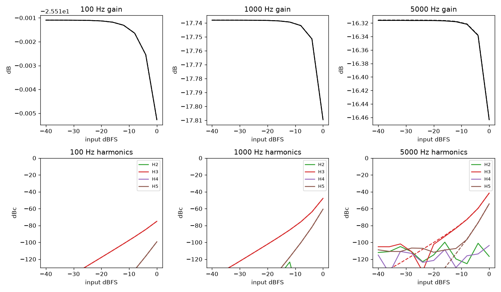
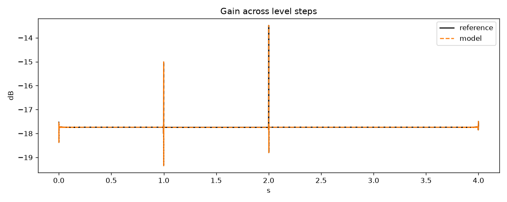

# Example clipper vs SPICE, default knobs: PASS

| Check | Result | Value | Limit | Worst case |
|---|---|---|---|---|
| frequency response | pass | 0.006814 | 0.1 | sweep at -6 dBFS |
| static gain | pass | 0.0004976 | 0.1 | 5000 Hz at -28 dBFS |
| harmonics | pass | 0.5268 | 1 | H3 of 5000 Hz at -12 dBFS |
| attack | pass | 0 | 0.05 | no gain change in either |
| release | pass | 0 | 0.05 | no gain change in either |
| intermodulation | pass | 0.0811 | 1 | -6 dBFS |
| burst waveform null | pass | -105 | -40 | dB relative to reference |

