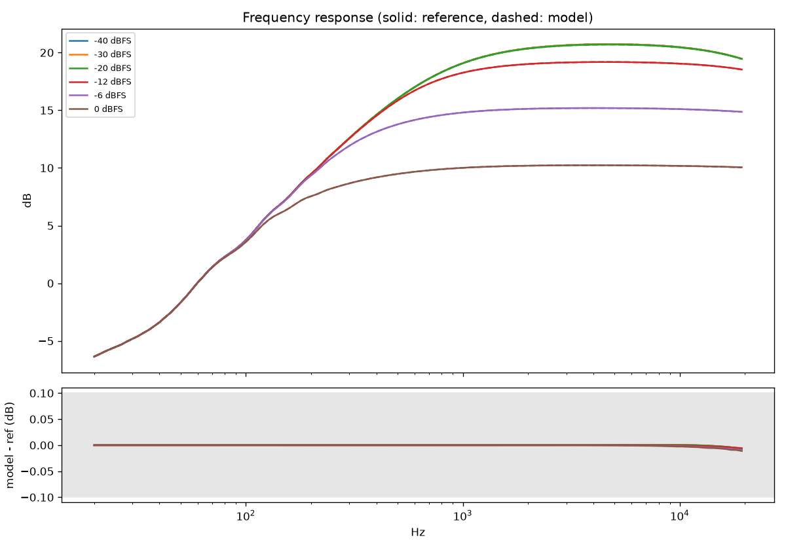
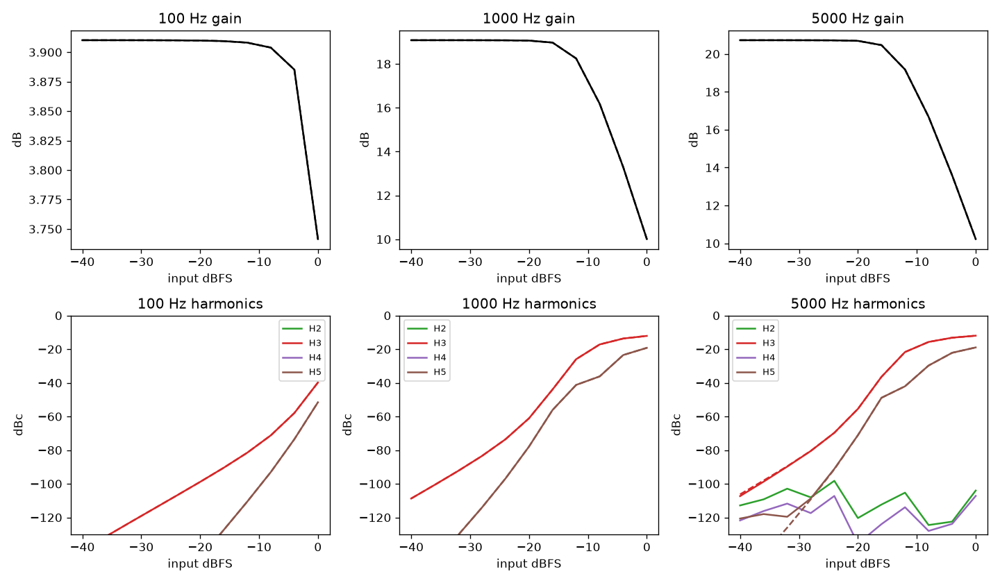
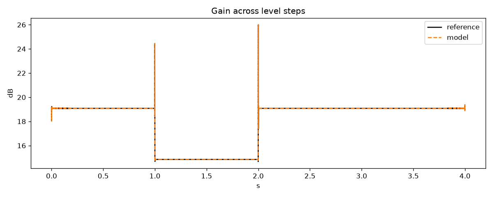

# Example clipper vs SPICE, max knobs: PASS

| Check | Result | Value | Limit | Worst case |
|---|---|---|---|---|
| frequency response | pass | 0.01127 | 0.1 | sweep at 0 dBFS |
| static gain | pass | 0.0005536 | 0.1 | 5000 Hz at 0 dBFS |
| harmonics | pass | 0.2003 | 1 | H3 of 5000 Hz at -32 dBFS |
| attack | pass | 0 | 0.05 | reference 0.00 ms, model 0.00 ms |
| release | pass | 0 | 0.05 | reference 0.07 ms, model 0.07 ms |
| intermodulation | pass | 0.00966 | 1 | -6 dBFS |
| burst waveform null | pass | -90.21 | -40 | dB relative to reference |

