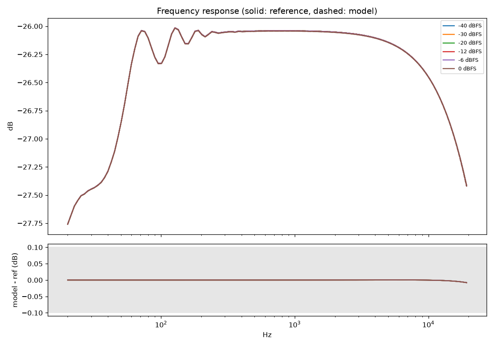
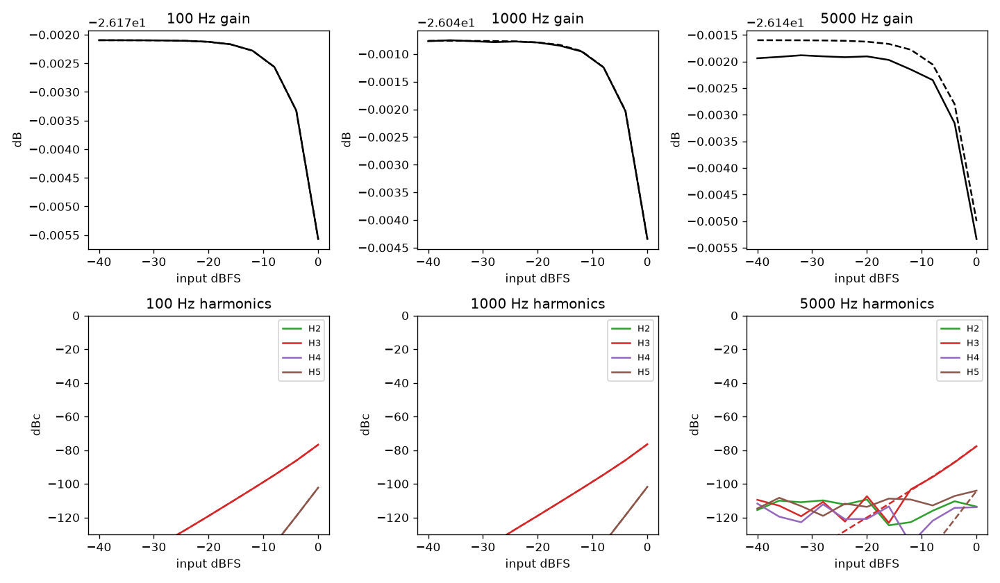
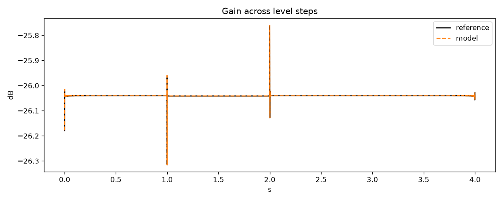

# Example clipper vs SPICE, min knobs: PASS

| Check | Result | Value | Limit | Worst case |
|---|---|---|---|---|
| frequency response | pass | 0.007952 | 0.1 | sweep at 0 dBFS |
| static gain | pass | 0.0003724 | 0.1 | 5000 Hz at -12 dBFS |
| harmonics | pass | 0.1987 | 1 | H3 of 5000 Hz at -4 dBFS |
| attack | pass | 0 | 0.05 | no gain change in either |
| release | pass | 0 | 0.05 | no gain change in either |
| intermodulation | pass | 0.7336 | 1 | -6 dBFS |
| burst waveform null | pass | -103.1 | -40 | dB relative to reference |

